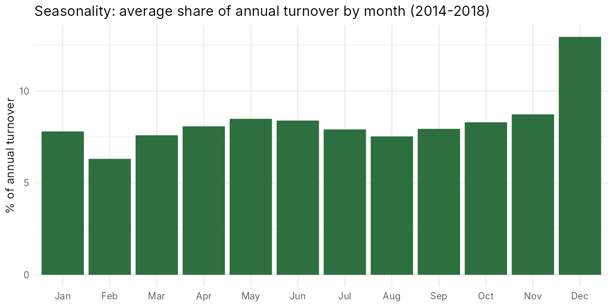
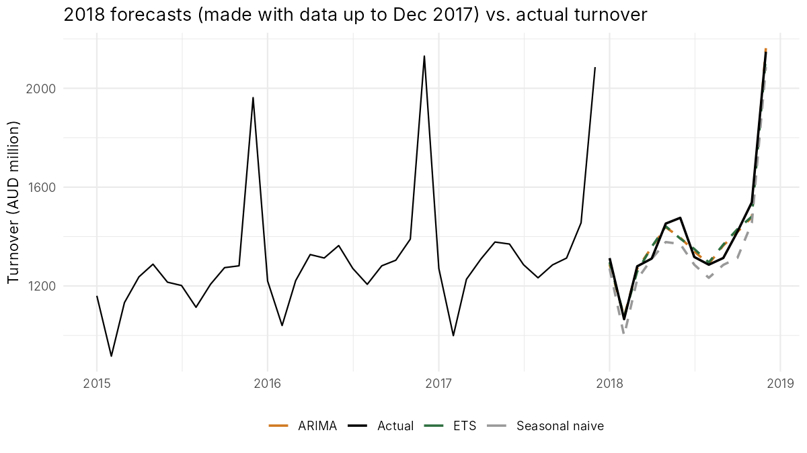
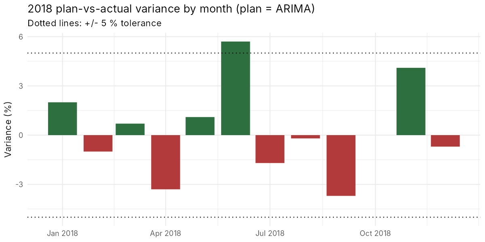

# Retail Sales Forecasting & Plan-vs-Actual Variance Analysis (R)

A controlling-style analysis of monthly clothing retail turnover in Australia: forecast next year's sales the way an annual plan is built, compare the plan with actual results, and explain where the deviations come from. A clustering step then groups retail industries by growth and seasonality.

**Tools:** R · forecast (ETS, ARIMA) · dplyr / tidyr · ggplot2 · k-means clustering

## Data

Monthly retail turnover (AUD million) by state and industry, 1982–2018, published by the Australian Bureau of Statistics. The dataset is loaded from the open-source R package [tsibbledata](https://github.com/tidyverts/tsibbledata) (`aus_retail`). The focus series is **clothing retailing, all of Australia** (sum of the 8 states, Apr 1988 – Dec 2018, 369 months).

## Questions

1. How has clothing turnover developed, and how strong is seasonality?
2. Which forecasting method gives the most reliable 12-month plan, and does it beat a simple benchmark?
3. Using the forecast as the 2018 plan: where did actual sales deviate, by month and by state?
4. Which retail industries behave similarly in terms of growth, seasonality and volatility?

## Method

| Step | What was done |
|---|---|
| Exploration | Trend chart, year-over-year growth, average monthly share of annual turnover (2014–2018) |
| Forecasting | Seasonal naive (benchmark), ETS and ARIMA, all on log scale. Rolling 12-month evaluation like an annual budget: train to Dec 2016 → forecast 2017; train to Dec 2017 → forecast 2018. Accuracy measured with RMSE, MAE and MAPE |
| Plan vs. actual | Best model's 2018 forecast = plan. Monthly variance in AUD and %, months outside ±5 % flagged. Same logic applied to each state |
| Segmentation | 15 non-overlapping retail industries, 2009–2018. Features: average growth p.a., December share of turnover, volatility of YoY growth. Standardised, k-means with 3 clusters |

## Key findings

**Seasonality dominates.** December accounts for about 12.9 % of annual clothing turnover, compared with roughly 6.3 % in February (the weakest month). Any monthly plan without seasonality would be wrong by large amounts.



**Simple benchmarks are hard to beat.** Averaged over the two forecast years, the three methods are almost equal (MAPE: ARIMA 3.16 %, ETS 3.17 %, seasonal naive 3.18 %). The ranking flips between years: in 2017, when growth slowed to +0.9 %, simply repeating last year's figures was best (MAPE 2.2 %). In 2018, when growth returned (+4.4 %), ARIMA was best (MAPE 2.0 %) and the naive method missed the growth (4.2 %). For planning, this means a model should always be checked against a simple benchmark, and the growth assumption matters more than model choice.



**Plan vs. actual 2018 (plan = ARIMA).** Total 2018 turnover was AUD 16,920 m against a plan of AUD 16,877 m, a variance of **+0.3 %**. Only one month exceeded the ±5 % tolerance: **June (+5.7 %)**. The largest negative deviations were September (−3.7 %) and April (−3.3 %).



**By state, the national result hides big differences.** South Australia missed its plan by **−10.9 %** and Western Australia by −4.2 %, while Victoria (+4.6 %) and the ACT (+4.3 %) beat theirs. In a real company, these regions would be the first place to look for causes (store openings or closures, local demand, promotions).

**Three industry segments.**
- *Christmas-driven:* clothing, footwear & accessories, department stores, electronics, recreational goods. High December share (12.6–15.1 %), low to moderate growth.
- *Steady growth, low seasonality:* supermarkets, cafes & restaurants, takeaway food, pharmacy & cosmetics, hardware & garden, furniture, other retailing. Growth of about 3–7 % p.a.
- *Stagnating / volatile:* newspapers & books (−4.1 % p.a.), specialised food, liquor.



## Limitations

Only two forecast years were evaluated, so the model comparison is indicative. Forecasts use turnover history only, with no prices, promotions or macroeconomic drivers. Figures are nominal (not inflation-adjusted).

## Files

- `analysis.R`: complete analysis, from data download to charts and tables
- `output/`: charts (`.png`) and result tables (`.csv`), e.g. `plan_vs_actual_monthly_2018.csv`, `plan_vs_actual_by_state_2018.csv`, `model_accuracy_by_year.csv`, `industry_clusters.csv`

## How to run

```r
install.packages(c("forecast", "dplyr", "tidyr", "ggplot2"))
source("analysis.R")   # downloads the data on first run, writes results to ./output
```

Tested with R 4.3.3 and forecast 8.21.1.
